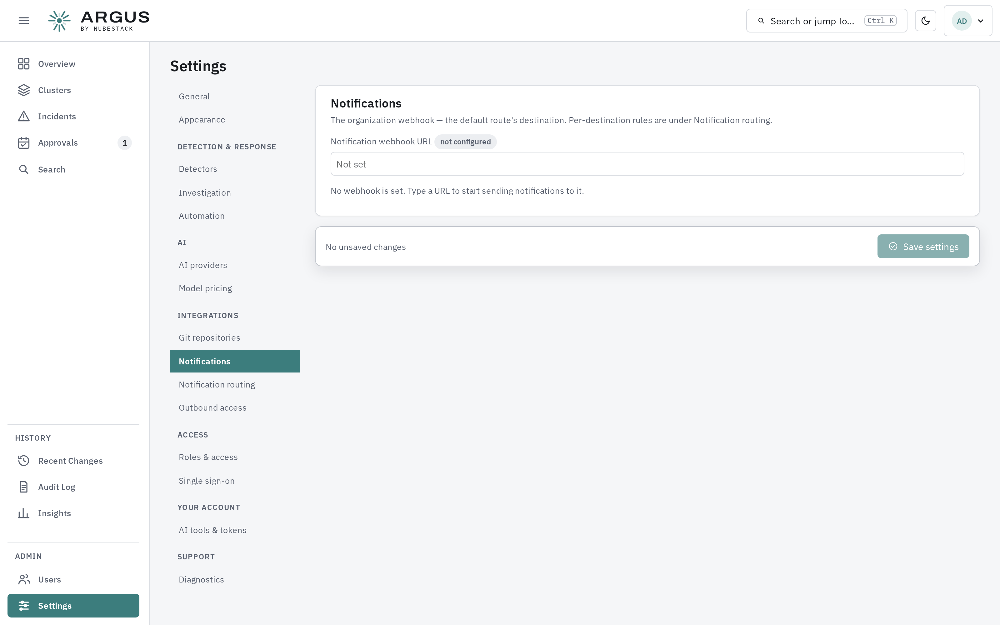

# Notifications

ARGUS posts to a webhook when something happens that a person should know about. Configure
it under **Settings → Notifications**.

## Configuring the webhook

Set the webhook URL and save. Leaving the field blank keeps the current webhook unchanged;
to remove one, use the explicit clear option rather than blanking the field.

Point it at whatever your team already watches — a chat integration, an alert router, or
your own receiver.

## Routing to more than one place

**Settings → Notification routing** sends notifications to different webhooks by cluster
group, minimum severity and what happened — for example high and above from production
clusters to an on-call channel, everything else to a team channel.

| Part | What it is |
|---|---|
| Destinations | A name and a webhook URL. The URL is shown only while you enter it; afterwards ARGUS reports only that one is set, because a webhook URL usually carries its own access token |
| Rules | Considered in order. Each matches a cluster group, a severity floor — **High and above** includes critical — and a kind of event, and names a destination |
| Default rule | Always last and always matches, sending to the organisation webhook above. Nothing is ever dropped |

Saving replaces the whole table in one step, so notifications are never routed by half an
edit. Off by default: with no rules, everything goes to the organisation webhook.

## What it is for

Notifications are for things that stop progressing without a person:

- a high-severity incident opening
- a plan waiting for approval, and one that has been waiting too long
- an execution that failed
- a pull request that has sat unmerged
- a validation that could not confirm an outcome, or an incident reopening

A plan that has been in the queue for days is escalated rather than silently waiting, so an
approval queue nobody is watching becomes visible instead of becoming a backlog.

## Keep it narrow

Route notifications narrowly at first. A quiet, trusted channel is more useful than a busy
one people learn to ignore, and ARGUS is capable of being noisy on a fleet that has not had
its detector settings tuned.

If notifications are too frequent, the fix is usually upstream: tune detectors, add
tolerations for accepted conditions, or set storm protection. See
[What ARGUS detects](../incidents/detection.md).

## See also

- [What ARGUS detects](../incidents/detection.md)
- [Tolerations](../incidents/tolerations.md)
- [Approving a fix](../remediation/approvals.md)
