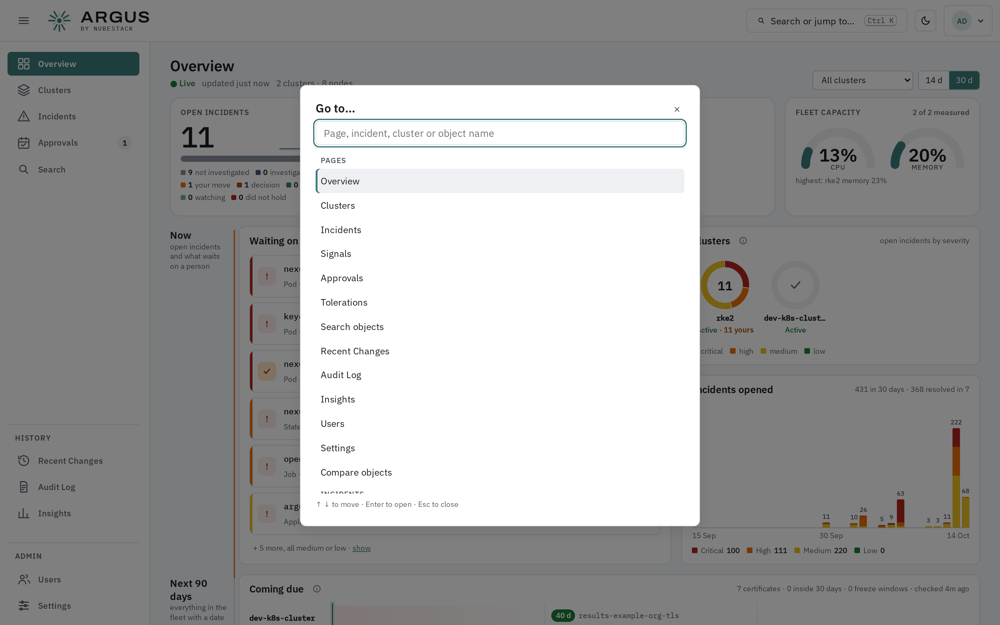

# Search and compare

**Search** finds an object across every cluster you can see. **Compare** puts two objects
side by side and shows what differs. A command palette reaches either from anywhere.

## Search

*Results are grouped by cluster, with each cluster saying whether it answered.*

Type a name, namespace, label or image. Each result gives the object's kind and namespace, its
status, and which field matched. Select one to open it in the
[object panel](object-panel.md). A cluster whose agent did not answer is listed as such,
rather than appearing to have no matches.

## Compare

*What differs is summarised first, spec before status, then shown line by line.*

Pick object **A** and object **B** — of one kind, from the same cluster or different ones.
**What differs** lists the changed fields, separating what the objects are told to do from
what they report. Below, the two objects' YAML is shown **Side by side** or **Unified**.

| Option | Effect |
|---|---|
| Only changed lines | Hides identical lines |
| Spec only | Compares what the objects are told to do |
| Include status | Adds what they report |
| Ignore per-instance differences | Hides fields that always differ, such as names generated for each copy |

Bookkeeping fields — resource versions, managed fields, creation times — are hidden on both
sides. **Swap** exchanges A and B, and **Change…** picks a different object.

## Command palette

Press ++ctrl+k++, or select **Search or jump to…** in the header, to go to any page, incident,
cluster or object by name.

## See also

- [The object panel](object-panel.md)
- [The cluster page](cluster-page.md)
